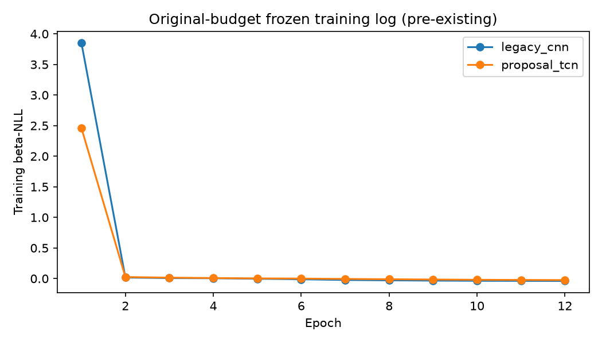

# Frozen TCN diagnosis, fourth batch (2026-11-06)

**Available, not default, not promoted.** This is a bounded diagnosis, not a fix or
M3 acceptance. Primary work is the [causal streaming chain](../proposal_alignment_stream/report.md).
All newly generated inputs are simulated IMU; GNSS is synthetic. Frozen models and
original-budget training/test results in `results/proposal_alignment_full/` were
read without rewriting them. No training, validation optimization, architecture
selection or test-driven hyperparameter change took place.

## Architecture and capacity

The locally loaded TCN has three Conv1d stages, channels 8→32→64→64,
kernel 5, strides 1/1/1, dilations 1/2/4; **37,734 parameters**. Legacy has
6→32→64→64, kernel 5, strides 1/2/2, dilations 1/1/1; **37,158 parameters**.
Thus this is the intended three-stage dilated architecture, not a low-capacity
placeholder. Both have receptive field 29 before global pooling/statistics of the
100-sample window. The proposal's rough 50–100k parameter aspiration is not met;
this comparable-capacity implementation was not resized based on held-out tests.
TCN adds roll/pitch and bias correction, so comparisons include input conditioning.
Internal same-padding is not positionwise causal; endpoint inference over the
trailing window is causal. The new stream exercises both checkpoint types.

The inherited training-script default was TCN despite the non-promotion decision.
It is now `legacy_cnn`, with a separate exploratory output path; TCN still requires
only explicit `--architecture proposal_tcn`. No checkpoint or activation changes.

## New seed scans and opening/detrending checks

`probe.py` runs retained checkpoints on **20 training seeds 100–119 and four
validation seeds 500–503**, each 600 s, endpoint stride 100. All **48**
seed/architecture outputs and variances are finite, with positive bounded variance.
This is a scan of checkpoints across data seeds, not 24 independently trained
networks. Dense seed-500 transform/jitter probes use stride 20.

| Forward-channel diagnostic, mean over seeds (m/s) | Legacy | TCN |
|---|---:|---:|
| Training RMSE | 0.499159 | 0.521232 |
| Validation RMSE | 0.568884 | 0.559893 |
| Validation first full-window endpoints, 1–5 s RMSE | 0.070763 | 0.018056 |
| Validation later RMSE | 0.571230 | 0.562237 |
| Validation linear-error-detrended RMSE | 0.559699 | 0.556686 |

Opening does not exhibit an explosion in these reference-conditioned scans;
linear detrending barely changes TCN error. Maximum absolute TCN forward prediction
across training/validation scans is 20.771130 m/s (training maximum). This does
not establish behavior before a full window (no prediction), nor rule out live
filter-conditioned failure. No detrending was added to deployed predictions.

The full prior test metrics already report reference-conditioned network RMSE by
channel. Equal-seed means, calculated here from that **pre-existing** evidence:
TCN forward/left/up **0.574932 / 0.002167 / 0.002208 m/s**, legacy
**0.589238 / 0.002459 / 0.002253 m/s**. TCN's worst forward standalone seed is
906 (0.618835 m/s); forward dominates absolute velocity error. This is diagnosis,
not test-based selection. Vertical variance failure from the earlier smoke is
not established as the cause of the full model's hybrid navigation failure:
hybrid uses fixed lateral/up NHC. Full test navigation remains the authoritative
pre-existing legacy **5.153636**, TCN **31.536755**, NHC **3.269130 m**; validation
TCN **4.042560** vs legacy **4.060636 m**. See the full report and metrics for all
seeds and exact configurations. Better raw network diagnostics do not imply better
closed-loop navigation.

## Mechanistic validation probes

All transforms below use validation seed 500 with corrected IMU and frozen weights.
Physical left/right reflection transforms polar acceleration, axial angular rate,
roll sign and expected body velocity consistently. Forward equivariance RMSE is
**0.145063 m/s** (left/up 0.003315/0.001856). The network is not exactly equivariant.
A body-axis yaw-π change should reverse forward/left velocity; forward equivariance
error is **24.383064 m/s**, showing a learned forward-axis prior. This transformed
vehicle convention lies outside the ordinary forward-driving training support:
no mathematical equivariance was promised by this architecture. Inertial velocity
symmetries are a plausible generalization limitation, not proof of the observed
navigation failure or memorization.

Flipping roll/pitch signs alone while holding IMU fixed is deliberately physically
inconsistent; it changes the forward prediction by **1.026684 m/s RMS**. Swapping
gyro/accel groups is an intentionally invalid channel-order probe, changing it by
**120.858492 m/s RMS**. These show input sensitivity; neither supports applying an
unmotivated sign/channel correction. Actual order is gyro xyz, accel xyz, roll/pitch,
and target body forward/left/up. Direct Rᵀv versus stored body label discrepancy
is **1.065814e-14** on validation seed 500. Labels are idx-1 and windows [idx-100:idx];
serving at idx retains the documented 10 ms lag. No demonstrated order/label bug.

Adjacent holdout fuzzing stays entirely within validation seed 500: endpoint
shifts −1/0/+1 sample give forward RMSE **0.615679/0.616937/0.617269 m/s**.
A deterministic random ±10-sample perturbation is retained in metrics.json.
Train/validation sequences are independent seeds, not neighboring splits of one
trajectory. Jitter is a sensitivity diagnostic, not proof against shared simulator
bias, same-drive leakage in other datasets, or validation overfitting.

Training curves were parsed and plotted from the **pre-existing** full run.log,
with no retraining. Final beta-NLL is −0.0386 legacy / −0.0244 TCN; these weighted
training losses are not raw Gaussian NLL or navigation RMSE. No per-epoch
validation curve was retained by that training run. The new metrics preserve
opening, trend, seed/channel stats and every probe. There is no new winner chosen.

Remaining diagnosis gaps: live closed-loop per-channel failure localization over
all original test trajectories, filter/reference conditioning ablations, new
initialization-seed retraining, independent-road and cross-device validation.
No causal attribution to memorization, symmetry, CUSUM latching or correlation
inflation is established by these probes. No reliable validation-only fix was
shown, so no redesign was attempted. The new streaming assembly advances the
proposal while the bad TCN navigation result stays visible.

Reproduce locally:
`OPENBLAS_NUM_THREADS=1 OMP_NUM_THREADS=1 PYTHONPATH=. .venv/bin/python results/proposal_tcn_diagnosis/probe.py`.
